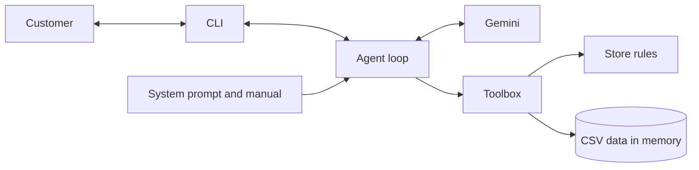

# Empório da Música Support Agent

[](https://github.com/devBandeiraa/emporio-da-musica-agent/actions/workflows/ci.yml)

A text support agent for Empório da Música, a fictional musical instrument store in Campo Grande, Brazil. It answers the questions that keep the team busy: opening hours, order status, prices, availability and returns. Customers talk to Sol, a virtual assistant, in Portuguese.

Sample conversations are in [`examples/`](examples/). Every data problem found, and the decision taken, is in [`ASSUMPTIONS.md`](ASSUMPTIONS.md).

## How to run

You need Python 3.12+ and a free [Gemini API key](https://aistudio.google.com/apikey). Tests do not need a key.

### Local

```bash
python -m venv .venv
source .venv/bin/activate          # Windows: .venv\Scripts\activate
pip install -e ".[dev]"
cp .env.example .env               # then set GEMINI_API_KEY
python -m emporio_agent            # add --verbose to see tool calls
```

### Docker

```bash
docker build -t emporio-agent .
docker run --rm -it --env-file .env emporio-agent
```

### Development commands

| Task | Make | Without Make |
|---|---|---|
| Install | `make install` | `pip install -e ".[dev]" && pre-commit install` |
| Test | `make test` | `pytest --cov` |
| Lint | `make lint` | `ruff check . && ruff format --check .` |
| Run | `make run` | `python -m emporio_agent` |
| Real-model scenarios | | `python -m evals.runner --pause 8` |

### Configuration

| Variable | Default | Purpose |
|---|---|---|
| `GEMINI_API_KEY` | required | Model access |
| `LLM_MODEL` | `gemini-3.5-flash-lite` | Model for conversations |
| `REFERENCE_DATETIME` | system clock | Frozen "now". `.env.example` sets `2026-03-25T10:00:00` to match the sample data |
| `DATA_DIR` | `data` | Folder with the CSV files |

## Architecture



The agent sends the conversation to the model. When the model asks for a tool, the agent runs it and returns the result. This repeats until the model answers, with a limit of 8 rounds per message.

Operational data (prices, stock, promotions, orders) only reaches the model through four tools. Store rules (returns, hours, payment, shipping, warranty) are in the system prompt.

| Tool | Purpose |
|---|---|
| `search_products` | Search by text, category and final price |
| `get_product_details` | Availability, specs, pricing, PIX, installments and alternatives |
| `get_order` | Order data, after matching the customer's e-mail or phone |
| `register_ticket` | Complaints, cancellations, data deletion and human handoff |

| Module | Responsibility |
|---|---|
| `models.py`, `store.py` | Typed records, validated when the CSVs load |
| `catalog.py` | Accent-insensitive, typo-tolerant search |
| `policies.py` | Discounts, installments, return windows, contact matching |
| `tools.py` | Tool schemas, input validation, error handling |
| `agent.py`, `llm.py` | Conversation loop and model client |
| `prompts/` | Versioned system prompt and manual |
| `evals/` | Scenarios against the real model |

## Technical decisions

| Decision | Choice | Why | Trade-off |
|---|---|---|---|
| Agent approach | Function calling with a hand-written loop | Around 40 lines, easy to read and to test with a fake client. A framework would add concepts without adding behavior here | Features like streaming or checkpoints would be written by hand |
| Not a SQL agent | Fixed, typed tools | A SQL agent would put the `customers` table within the model's reach. With tools, privacy is enforced by code, not only by prompt | Questions the tools did not anticipate go unanswered |
| Policies | Full manual in the system prompt, no RAG | It is about 3k tokens. Retrieval would add a way to miss a rule and save almost nothing | A much larger manual would need retrieval |
| Manual format | Hand-reviewed Markdown instead of parsing the PDF at runtime | Automatic extraction shifts the opening hours table and reads Saturday as 09:00–18:00 | Manual updates are also manual here |
| Provider | Gemini API, free tier | The challenge allows free models, and an evaluator can run this without paying. The first version used Claude, but no paid key was available, and a default model that was never run is worse than a changed one | Free quotas are small: 500 requests per day per model |
| Model | `gemini-3.5-flash-lite`, configurable | Chosen by running the scenarios, not by its spec sheet. See [Evaluation](#evaluation) | A lighter model follows instructions less consistently |
| Rule enforcement | Code first, prompt second | When a prompt rule was not enough, the tool started supplying the answer. Payment sentences, shipping sentences and alternatives are built in code, after the model got them wrong | Tool responses are shaped around what the model needs |
| Prompt order | Stable text first, clock last | Keeps a shared prefix, which Gemini can reuse through implicit caching | Cache hits are decided by the API |
| Retries | Hand-written, for 429 and 5xx only | With the SDK's `retry_options`, valid requests intermittently returned 403. The cause was not proven, so the code avoids that path | A few more lines to own |
| Data layer | Pydantic over `csv`, in memory | 65 products need neither pandas nor SQL. Bad data fails at startup. Money uses `Decimal` | Data is read once at startup. A real system would replace `store.py` |
| Math | Discounts, installments and dates run in code | Models make arithmetic mistakes; pure functions can be tested at the boundaries | More code than asking the model |
| Search | Own index with RapidFuzz | Handles "gd 20" and typos. Fuzzy matching only runs on structured fields, or "amplificador" would match guitars | Synonyms are a hand-written list |
| Interface | CLI | The challenge is about the agent | Not usable by real customers |
| History | In memory, per session | A conversation needs nothing more, and history holds personal data after an order is verified, so nothing is written to disk | A restart loses the conversation |

## Data issues found and how they were handled

These are the problems that most affect the agent's answers. [`ASSUMPTIONS.md`](ASSUMPTIONS.md) has the complete list.

| Issue | Handling |
|---|---|
| Descriptions of products 135–144 contradict their name or specs | Dropped at load time, so they can neither be quoted nor match a search |
| Discontinued item 136 shows 13 units; `coming_soon` item 130 shows 2 | Available means `active` and in stock |
| 3 categories have no products, while the manual claims 300+ instruments | The agent answers from the catalog and says when a category is empty |
| Only 4 of 25 promotions are active, and there are no dates | The model never receives an expired discount's percentage |
| Orders 3 and 20 differ from quantity × price, and `order_items` has no unit price | The recorded total is reported and never recalculated |
| 5 PIX orders show no discount; 3 orders break the installment minimums | The agent reports what is recorded and hands disputes to a person |
| Orders end in March 2026 | `REFERENCE_DATETIME` freezes "today" at 2026-03-25 |
| No date leaves a delivered order inside the 7 or 30-day windows | Reported honestly. Tests inject other dates to cover the in-window path |
| Customers 11 and 43 share an e-mail | Contacts are compared with the owner of the order, never searched |
| Phone, e-mail and installment rules conflict inside the manual | The more specific section wins |
| The manual has no rule for cancellations | The agent opens a ticket instead of inventing one |

## Assumptions

- Receipt date is not recorded, so `estimated_delivery` stands in for it, only on `delivered` orders. A `shipped` order has not started any return window.
- The 7-day preference exchange counts from receipt, as the 7-day return does.
- All orders are online purchases, since the data has no channel field and all of them follow a shipping flow.
- Requiring an order number plus e-mail or phone is a design decision based on the LGPD. The manual does not define a verification procedure.
- `coming_soon` means the product cannot be bought yet. The manual does not define it.

## Evaluation

Pytest covers tools, rules and the loop with a fake client, and never calls the real model. `evals/` runs 22 scenarios against the real model and checks which tools were called, what the reply says or avoids, and that every price in a reply comes from a tool, the manual or the customer.

```bash
python -m evals.runner --pause 8                    # report in eval-results/
python -m evals.runner --pause 8 --write-examples   # also regenerates examples/
```

A full run uses about 47 requests. The files in `examples/` are generated by this command and never edited by hand.

The final run, on the released code with `gemini-3.5-flash-lite`, passed 22 of 22 scenarios and used 47 requests. That is a single run of a model that varies: the six runs made on the last day, while the final fixes went in, scored between 20 and 22, and their checks kept getting stricter along the way.

Passing checks was not enough. Reading the conversations found errors the checks had missed, such as a card price presented as the PIX price and a promise to notify a customer. Two of those last six runs scored 22 of 22 with wrong replies. One opened a ticket nobody had accepted and invented a guitar's popularity. A later one refused to recommend anything, a regression caused by the fix for that popularity claim, and called the purchase date the shipping date. Each one became a fix and a stricter check.

### Model comparison

| Model | Result | Notes |
|---|---|---|
| `gemini-3.5-flash-lite` | Chosen | Replies usually took 1 to 7 seconds. It answered the string-count question correctly in every full run |
| `gemini-3.1-flash-lite` | 19 of 21 | One real error: it read "how many strings does this bass have?" as a request for accessories and gave no answer. The other failure was a check that was too strict |
| `gemini-3.6-flash` | Not finished | Simple calls took 2 to 33 seconds, and its free quota ran out during the run, so it could not be compared fairly |

The comparison ran on 21 scenarios, before the out-of-hours scenario was added.

## Git workflow and CI

- `main` only changes through pull requests, with one exception: the initial commit.
- One branch per unit of work, in Conventional Commits, with one commit per logical change.
- Pull requests explain what, why and how to test.
- Merges use a merge commit, only with green checks, to keep the real history. There is no squash and no force push. The first pull request is the one exception to green checks, because it came before the CI workflow.
- The provider change has its own branch, `refactor/gemini-client`, so the history shows why it happened.
- `ci.yml` runs `ruff check`, `ruff format --check`, `pytest` with coverage on Python 3.12 and 3.14, and a Docker build with a smoke test.
- `eval.yml` runs the real-model scenarios on demand, using a GitHub Secret, and publishes the result as an artifact.
- `pre-commit` runs ruff and detects private keys.

## Known limitations and next steps

| Limitation | Next step |
|---|---|
| The free tier allows 500 requests per day per model, plus a per-minute limit. When it runs out, customers get the fallback reply | A paid tier, with an alert before the quota ends |
| The model is not fully consistent. The same scenario can pass in one run and fail in another | A stronger model, with the scenarios running on each prompt change |
| It sometimes calls a customer by a name taken from an e-mail address, even though the prompt forbids it. The complaint scenario still does this ("Ana"), with no order looked up. No data leaks, but the name is a guess | Hide the e-mail from the reply step, or remove names before verification |
| Recommendations can add general music knowledge beyond the catalog, such as nylon strings being easier on beginners' fingers. Runs before the final one also invented popularity claims, which the prompt forbids and a scenario now checks | Decide with the store how much opinion the agent may give |
| Some rules are only followed most of the time, such as giving the tracking code. The final fix removed the separate fields from the tool response, so the code can no longer be skipped by quoting the date alone, but one run does not prove it holds | Run the scenarios several times per release and track the pass rate |
| Data is static: CSVs load at startup | A real database behind `store.py` |
| Return windows depend on `estimated_delivery` | Record the real delivery date |
| The agent knows the weekly hours, not the holiday calendar | Add the store's calendar |
| Tickets go to a local JSONL file and hold contact data | The help desk the team already uses, with retention rules |
| No shipping quotes outside Campo Grande | A carrier API, using the customer's postal code |
| Failed order lookups are limited per conversation, so a new session resets the count | Limit by customer or IP in a real channel |
| Customers 11 and 43 share an e-mail. If they are two people, each could open the other's orders | Merge or fix the records |
| CLI only, while the manual names WhatsApp as the main channel | A webhook that reuses `Agent` |
| No memory between sessions | Persistent history with retention rules that respect the LGPD |
| The interactive Docker run was not tested by hand, because Docker Desktop would not start on the development machine. CI builds the image and runs a smoke test on every change | Hold one real conversation inside the container |

## Use of AI coding assistants

I used Claude Code (desktop app) with Claude Opus 5.5 throughout this project, and it wrote most of the code. This is how we worked.

I started from a brief with phases, Git rules and my own first reading of the data. It included an approval gate: nothing could be implemented until I approved a proposal.

In the first phase, Claude profiled the CSVs and read the PDF. It confirmed my findings, corrected three of them against the manual and found new ones, like the misaligned opening hours table and the discontinued product with stock. I asked for honest pushback, and it argued against pandas and SQLite for this data size. I agreed.

From there, Claude Code wrote the code, tests, commits and pull requests inside the workflow I had set. The provider decision was mine: I had no paid key, so we compared the free options and moved to Gemini.

It was not always right, and part of the value came from checking it. It treated a GitHub permission as a blocker when it was not. It blamed a model's reliability before finding the cause was an exhausted quota. Its first runs passed most checks, but reading the conversations showed real errors, and some of its own checks turned out to be wrong. One of its late fixes made the agent refuse to recommend products, while every check still passed.

The conversations in `examples/` are real agent output and were not written by hand.
